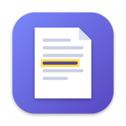

# Pagewise

Ask your PDFs anything, on your Mac. Pagewise answers with Apple's on-device
AI, and every answer shows the exact sentences it came from. Click one to see
it highlighted on the page. If the answer isn't in your PDFs, Pagewise says so.

Free and open source. No account, no server, no tracking. Your PDFs never
leave your Mac.

**[pagewise.bnapier.dev](https://pagewise.bnapier.dev)**

## Install

[Download Pagewise](https://github.com/barry-napier/pagewise/releases/latest/download/Pagewise.dmg),
open it, and drag Pagewise to Applications. Pagewise updates itself.

Needs macOS 26 or later, an Apple Silicon Mac, and Apple Intelligence turned on.

## Use

- **Add PDFs:** drop PDFs or folders into the window, click **+**, or drop them
  on the Dock icon. Scanned PDFs work too: Pagewise reads the page pictures.
- **Ask:** pick one PDF, several, or **All PDFs**, and type a question.
- **Check the proof:** each answer lists the sentences it is based on. Click one
  to open the page with that sentence highlighted. Under each answer,
  "Searched …" shows which pages Pagewise looked at.
- **Ask from anywhere:** press **⌃⌥P** in any app. With a PDF open in
  Preview, the box asks about that PDF. Otherwise it asks your whole library.
  You can change the shortcut in Settings.
- **Watch folders:** in Settings, pick folders like Downloads. New and changed
  PDFs are added and indexed by themselves. Indexing can pause on battery.
- **Tables:** open a PDF's **Tables** tab and click **Find Tables**. Copy any
  table as CSV, or save it as a file.
- **Summaries:** ask for a summary of one PDF. Pagewise sums up each part, then
  the whole.

## How it works

Apple's on-device model reads about 4,000 tokens at once, which is three or
four pages. So Pagewise never sends it a whole PDF:

1. **Read.** Each page's text is pulled out. Pages with no text, like scans, go
   through Apple's Vision text reader.
2. **Index.** Pages are cut into pieces of about 120 words. Each piece gets a
   meaning fingerprint from Apple's on-device `NLContextualEmbedding`, and goes
   into a word index (SQLite FTS5). Both are saved, so reopening is instant.
3. **Search.** A question is matched by meaning and by words, and the two
   rankings are joined.
4. **Answer.** As many matching pieces as fit go to Apple's model, which must
   reply in a fixed shape: the answer, and sentences copied from the sources.
5. **Check.** Each quote must really be in the PDF (small spacing and reading
   differences are allowed). Quotes that fail are dropped. With no quote left,
   Pagewise says it couldn't check the answer, and shows the answer only if you
   ask. Quotes that don't support the answer are dropped too.

On systems where Apple's model holds more, Pagewise uses the extra room by itself.

## Privacy

- Your PDFs are read and answered on this Mac with Apple's own tools. Nothing
  is uploaded.
- Pagewise never changes your PDFs.
- The index and chats are stored only in `~/Library/Application Support/Pagewise`.
  **Settings > Delete Index and Chats** really deletes them.
- To ask about the PDF open in Preview, Pagewise asks Preview for the file's
  path. macOS asks your permission once. Pagewise never controls Preview.
- The only network use is updates: checking for them and downloading them from
  this repository's releases.
- The debug log in `~/Library/Logs/Pagewise` never holds your PDFs or questions.

## Build from source

You need Xcode 26 or later, [XcodeGen](https://github.com/yonaskolb/XcodeGen)
(`brew install xcodegen`) and an Apple Development certificate.

```sh
./scripts/build.sh
```

This builds, signs with your certificate, installs to `/Applications`, and
relaunches Pagewise. On first run it writes your Team ID to
`Config/Local.xcconfig`, which is not committed. The Xcode project is generated
from `project.yml`. Edit that, not the project.

### Tests

```sh
xcodebuild -project Pagewise.xcodeproj -scheme Pagewise \
  -destination "platform=macOS,arch=arm64" test   # splitting, search, quote check, indexing, tables
./scripts/selftest.sh                             # debug build: asks the AI questions with known answers
```

Both use a made-up five-page lease (`Pagewise/Core/SamplePDF.swift`). Its last
page is a picture with no text, like a scan, and page four has a table. The
self-test asks seven questions, two of them with no answer in the PDF, and
prints a score. Run it after any change to search or prompts.

### Releases

`./scripts/ship.sh 0.2.0` pushes a version tag, and GitHub Actions builds,
signs, notarizes and publishes it. `./scripts/release.sh 0.2.0 --publish` does
the same from a Mac. The workflow file lists the secrets it needs.

## License

MIT. See [LICENSE](LICENSE).
